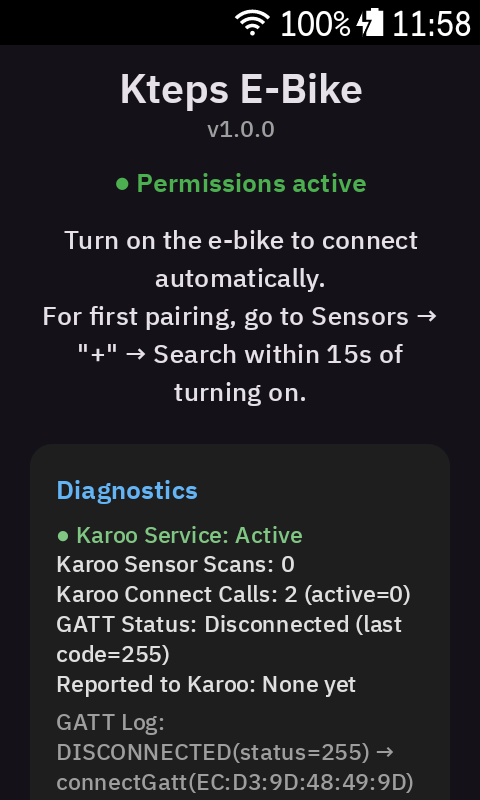
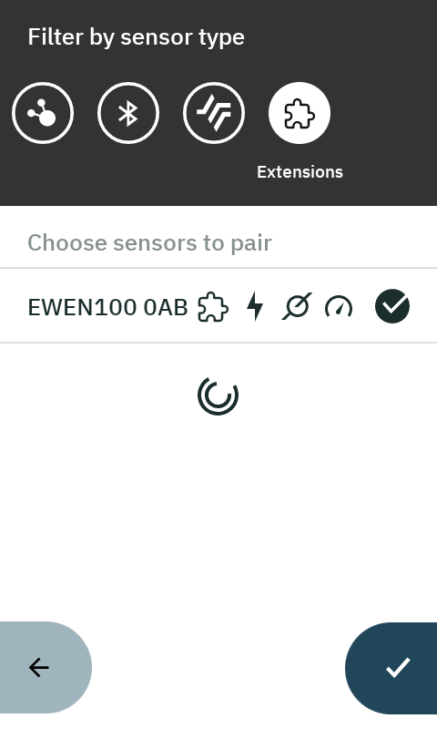
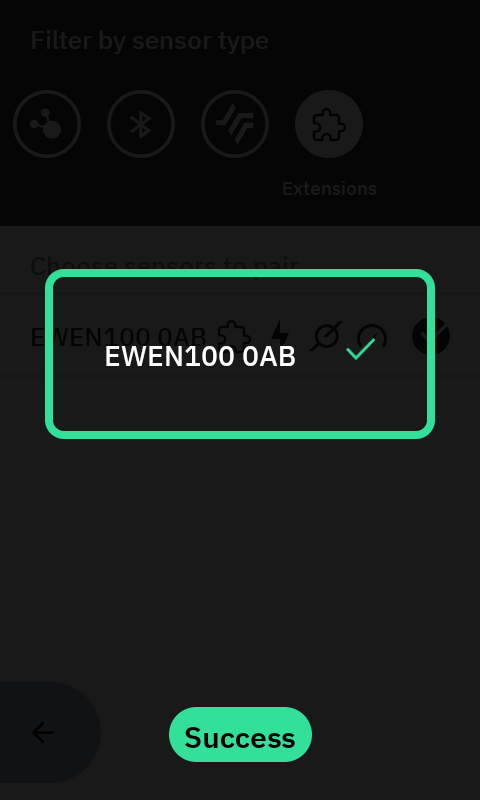
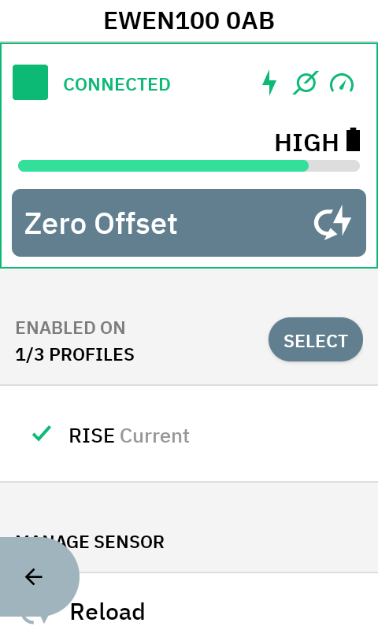
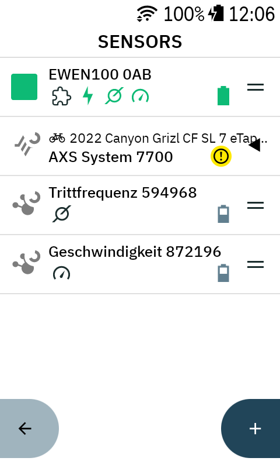
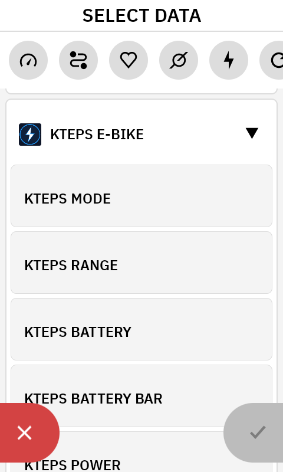
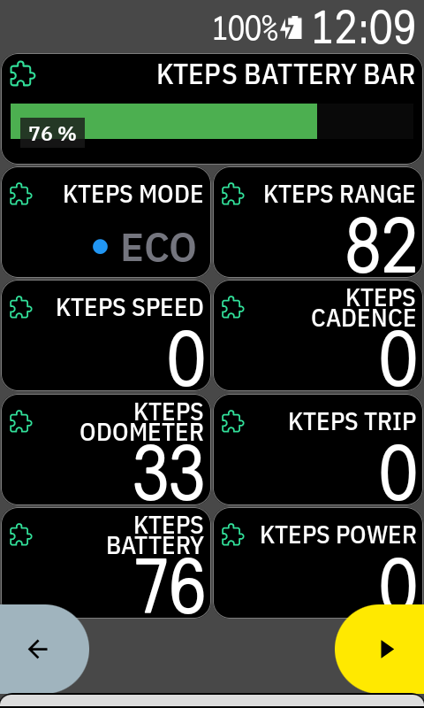

# 🚴‍♂️ Kteps – E-Bike Telemetry Extension for Hammerhead Karoo

A native **Karoo Extension (`karoo-ext`)** for the **Hammerhead Karoo** (Karoo 2 & Karoo 3) that connects to **Shimano STEPS e-bike systems** (e.g., **EP8, EP801, EP6, E8000, E7000**) directly via Bluetooth LE (such as the **EW-EN100** wireless unit) — no external hardware bridges required.

Because the wireless interface broadcasts e-bike telemetry (assist mode, battery state, remaining range, odometer) over Shimano's BLE GATT protocol rather than open ANT+ LEV, **Kteps** decodes these raw BLE notifications in real time. It provides **custom graphical and numeric e-bike data fields** while simultaneously feeding **speed, cadence, rider power (Watts), and battery level** into the **native Karoo system data fields** as a virtual sensor.

---

## 📸 Screenshots

| App / Setup | Sensor Search | Pairing | Sensor Details |
| :---: | :---: | :---: | :---: |
|  |  |  |  |

| Connected Sensor | Data Fields | In Action |
| :---: | :---: | :---: |
|  |  |  |

---

## ✨ Features

* **Direct BLE Pairing in the Karoo Sensor Menu:** Discovers compatible e-bikes directly under *Sensors -> `+` -> Search*.
* **Automatic BLE Reconnection & Live Battery Monitoring:** Automatically reconnects after mid-ride power-offs without resetting session trip distance, and tracks battery percentage via GATT notifications + periodic fallback polling.
* **Virtual Sensor for Native Karoo Data Fields:**
  * Feeds native Karoo data fields for **Speed** (`SPEED`, including average, max, and auto-pause), **Cadence** (`CADENCE`), **Rider Power** (`POWER`, including 3s/10s smoothed watts, Normalized Power, and zones), and **Sensor Battery** (`BATTERY_PERCENT`).
* **Graphical Assist Mode Tile (`Kteps Mode` / `Kteps Modus`):**
  * Clear text indicator paired with a colored status dot matching the official color scheme:
    * ⚫ **OFF** (Gray) – Motor assistance off
    * 🔵 **ECO** (Blue) – Eco mode
    * 🟢 **TRAIL** (Green) – Trail mode
    * 🟠 **BOOST** (Yellow/Orange) – Boost mode
    * 🔵 **WALK** (Cyan) – Walk assist selected (Standby)
    * 🟣 **WALK+** (Purple) – Walk assist active (Motor pushing)
* **Graphical Battery Bar (`Kteps Battery Bar` / `Kteps Akku Balken`):**
  * Visual progress bar styled to match native Karoo graphics with automatic color thresholds (**Green** > 50%, **Yellow** 21–50%, **Red** ≤ 20%).
  * **Responsive Percentage Badge:** When placed in a full-width data field (`gridSize == 60`), a dark percentage badge (e.g., `62 %`) automatically appears in the bottom-left corner of the bar, replicating the native Hammerhead e-bike battery field.
* **Dynamic Remaining Range (`Kteps Range` / `Kteps Reichweite`):**
  * A single, unified data field that automatically displays the remaining range in kilometers matching the currently active assist mode (`ECO`, `TRAIL`, or `BOOST`).
* **True Motor Odometer & Session Trip Counter:**
  * Decodes the internal total distance (odometer) of the drive unit down to the meter and calculates the current session trip distance since connection.
* **Localized (English & German):** Automatically displays English or German data field names based on Karoo system language.

---

## 📊 Available Data Fields

Once your e-bike is paired, the following data fields are available in the Karoo profile editor:

### 1. Custom Extension Data Fields (Category: *Kteps E-Bike*)

| Data Field (EN / DE) | Type | Unit / Format | Description |
| :--- | :---: | :---: | :--- |
| **Kteps Mode** / **Kteps Modus** | Graphical | `● OFF` / `ECO` / `TRAIL` / `BOOST` / `WALK` / `WALK+` | Current assist mode with color-coded status dot |
| **Kteps Range** / **Kteps Reichweite** | Numeric | `km` | Remaining range for the currently active assist mode |
| **Kteps Battery** / **Kteps Akku** | Numeric | `%` | Battery state of charge as a large numeric percentage (`0–100`) |
| **Kteps Battery Bar** / **Kteps Akku Balken** | Graphical | Progress Bar (+ `%` on full width) | Color-changing battery bar (Green/Yellow/Red) with percentage badge in 1-column full-width layouts |
| **Kteps Power** / **Kteps Leistung** | Numeric | `W` | Current rider pedal power in Watts |
| **Kteps Cadence** / **Kteps Kadenz** | Numeric | `RPM` | Current pedaling cadence |
| **Kteps Speed** / **Kteps Tempo** | Numeric | `km/h` | Current e-bike speed from the wheel sensor |
| **Kteps Trip** / **Kteps Trip-km** | Numeric | `km` | Trip distance ridden since connecting |
| **Kteps Odometer** / **Kteps Gesamt-km** | Numeric | `km` | Total motor odometer distance |

### 2. Supported Native Karoo System Fields

Because the extension registers as a multi-type sensor within Karoo OS, you can also use standard Hammerhead data fields alongside the custom ones:
* **Power:** Power, 3s Power, 10s Power, Average Power, Normalized Power (NP), Power Zones.
* **Cadence:** Cadence, Average Cadence, Cadence Zones.
* **Speed:** Speed, Average Speed, Max Speed.
* **Battery:** Sensor Battery Percentage.

---

## 🔬 Decoded BLE Telemetry Protocol

Communication uses Bluetooth Low Energy (GATT) via the standard Battery Service and the proprietary D-Fly / Telemetry characteristic.

### GATT Services & Characteristics
* **Battery Service:** `0000180f-0000-1000-8000-00805f9b34fb`
  * **Battery Level Characteristic:** `00002a19-0000-1000-8000-00805f9b34fb` (Read & Notify)
* **Auth / Discovery Service:** `000018ff-5348-494d-414e-4f5f424c4500`
* **D-Fly / Telemetry Service:** `000018ef-5348-494d-414e-4f5f424c4500`
  * **Telemetry Characteristic:** `00002ac1-5348-494d-414e-4f5f424c4500` (Notify via CCCD `0x2902`)

### Packet Structure on `00002ac1-5348-494d-414e-4f5f424c4500`

| Metric | Source / Packet Header | Byte Offset | Data Type & Conversion | Description / States |
| :--- | :--- | :---: | :--- | :--- |
| **Battery Level (%)** | `0x2A19` (Battery) | `bytes[0]` | `UInt8` (1:1 in `%`) | `0` to `100 %` |
| **Assist Mode** | `0x2AC1` -> Packet `0x02` (10 Bytes) | `bytes[1]` | `UInt8` | `0`=OFF, `1`=ECO, `2`=TRAIL, `3`=BOOST, `4`=WALK (Standby), `5`=WALK+ (Active pushing) |
| **Speed** | `0x2AC1` -> Packet `0x02` (10 Bytes) | `bytes[2..3]` | `UInt16 LE` / `10.0` | Speed in `km/h` (`0xFFFF` = Invalid / Stationary) |
| **Rider Power** | `0x2AC1` -> Packet `0x02` (10 Bytes) | `bytes[4]` | `UInt8` | Rider pedal input in `Watts` (`0` when coasting) |
| **Cadence** | `0x2AC1` -> Packet `0x02` (10 Bytes) | `bytes[5]` | `UInt8` | Pedaling cadence in `RPM` |
| **Walk Button State** | `0x2AC1` -> Packet `0x01` (15 Bytes) | `bytes[14]` | `UInt8` | `0x01` = Released, `0x00` = Walk button held down |
| **Total Odometer** | `0x2AC1` -> Packet `0x03` (19 Bytes) | `bytes[1..4]` | `UInt32 LE` | Total motor odometer in **meters** (divided by `1000.0` = `km`) |
| **Range BOOST** | `0x2AC1` -> Packet `0x03` (19 Bytes) | `bytes[13..14]`| `UInt16 LE` | Estimated remaining range in BOOST mode in `km` |
| **Range TRAIL** | `0x2AC1` -> Packet `0x03` (19 Bytes) | `bytes[15..16]`| `UInt16 LE` | Estimated remaining range in TRAIL mode in `km` |
| **Range ECO** | `0x2AC1` -> Packet `0x03` (19 Bytes) | `bytes[17..18]`| `UInt16 LE` | Estimated remaining range in ECO mode in `km` |

---

## 🛠️ Installation & Setup on Karoo

1. **Download the APK:**
   * Download the latest `kteps.apk` from the **GitHub Actions Artifacts** (or the *Releases* section).
2. **Sideload via ADB or Companion App:**
   * Enable Developer Options and *USB Debugging* on your Karoo.
   * Install the APK from your computer using ADB:
     ```bash
     adb install -r kteps.apk
     ```
   * *(Alternatively, sideload the APK using the Hammerhead Companion App on your smartphone).*
3. **Grant Permissions Once:**
   * Open the **“Kteps”** app once from the Karoo app drawer and grant the **Bluetooth permissions** (required by Android for BLE scanning).
4. **Pair Your E-Bike as a Sensor:**
   * Power on your e-bike.
   * On the Karoo, navigate to **Sensors -> “+” (Add) -> Search**.
   * Select your discovered bike (e.g., `EWEN100...` or `Shimano STEPS`) and confirm pairing.
5. **Add Data Fields to Your Ride Profile:**
   * Go to **Profiles** -> select your e-bike profile -> **Data Pages**.
   * Add any fields from the **Kteps E-Bike** category (e.g., *Kteps Mode* / *Kteps Modus*, *Kteps Battery Bar* / *Kteps Akku Balken*, *Kteps Range* / *Kteps Reichweite*) or native Karoo sensor fields.

---

## 📁 Project Structure

```text
app/src/
├── main/
│   ├── AndroidManifest.xml
│   ├── kotlin/io/github/indigodev/kteps/
│   │   ├── MainActivity.kt          # Permission setup & diagnostic UI (BLE)
│   │   ├── BlePermissions.kt        # Runtime BLE permission checks
│   │   ├── BleDiagnosticScanner.kt  # On-device BLE scanner & diagnostic tool
│   │   ├── ExtensionDiagnostics.kt  # IPC diagnostic state flow
│   │   ├── KtepsModels.kt           # AssistMode enum & telemetry data models
│   │   ├── ShimanoBleParser.kt      # Binary BLE packet parser (0x02, 0x03, 0x2A19)
│   │   ├── KtepsManager.kt          # BLE scanner, sequential GATT client & auto-reconnect
│   │   └── KtepsExtension.kt        # KarooExtension service, virtual sensor & RemoteViews tiles
│   └── res/
│       ├── layout/
│       │   ├── kteps_mode_view.xml    # Layout for the Assist Mode tile (colored dot + text)
│       │   └── kteps_battery_view.xml # Layout for the Battery Bar (ProgressBars + percentage badge)
│       ├── values/
│       │   └── strings.xml          # English default strings
│       ├── values-de/
│       │   └── strings.xml          # German localized strings
│       └── xml/
│           └── extension_info.xml   # Extension & DataType registration for Karoo OS
└── test/kotlin/io/github/indigodev/kteps/
    └── ShimanoBleParserTest.kt      # Unit tests for BLE protocol decoding
```

---

## ⚖️ Disclaimer & Legal Notice

* **Independent Project for Interoperability:** This is an independent, community-driven open-source project developed solely for the purpose of achieving interoperability between the Hammerhead Karoo bicycle computer and Shimano STEPS e-bike systems (in accordance with EU Directive 2009/24/EC Art. 6 / § 69e UrhG and Section 1201(f) of the US DMCA).
* **Pure Read-Only Telemetry (No Tuning):** This extension is strictly a **passive telemetry monitor**. It reads standard and proprietary BLE notifications broadcast by the wireless unit (speed, cadence, rider power, battery status, assist mode, and range). It **does not modify firmware**, **does not alter motor tuning parameters**, and **does not bypass or modify e-bike speed limits** (maintaining full compliance with EN 15194 and local traffic regulations).
* **Trademarks:** All product names, logos, brands, and registered trademarks mentioned in this repository are the property of their respective owners:
  * **Shimano**, **STEPS**, **EP8**, **EP6**, and **D-Fly** are registered trademarks of **Shimano Inc.**
  * **Hammerhead**, **Karoo**, and **Karoo 3** are trademarks of **Hammerhead Navigation Inc.** (a SRAM LLC company).
  * Use of these names, logos, and brands does not imply endorsement, sponsorship, or affiliation. This project is not affiliated with, authorized, maintained, or endorsed by Shimano Inc., Hammerhead Navigation Inc., SRAM LLC, or any of their affiliates.

---

## 📄 License

This project is licensed under the **Apache License 2.0** — see the [LICENSE](file:///c:/Development/projects/karoo-ep8/LICENSE) file for details.
